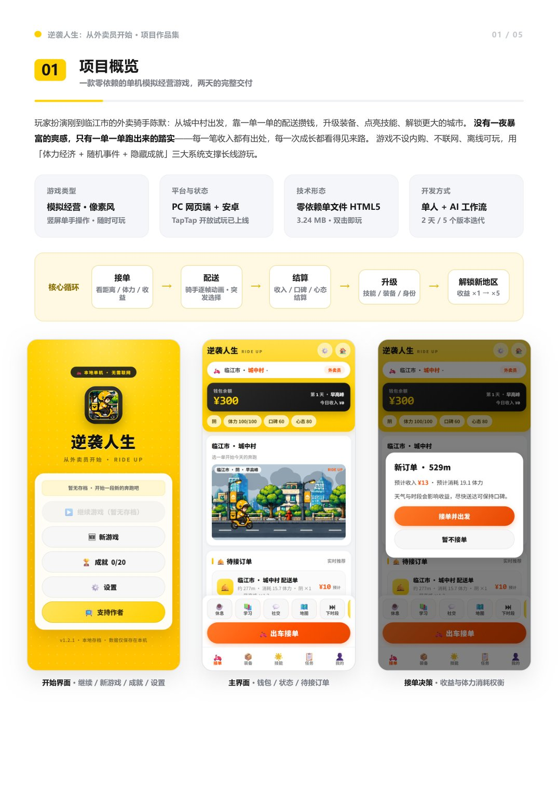
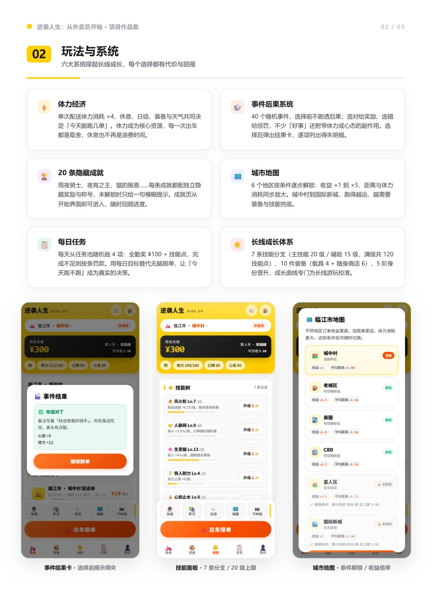
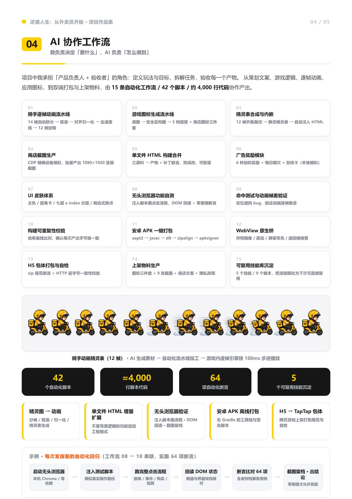
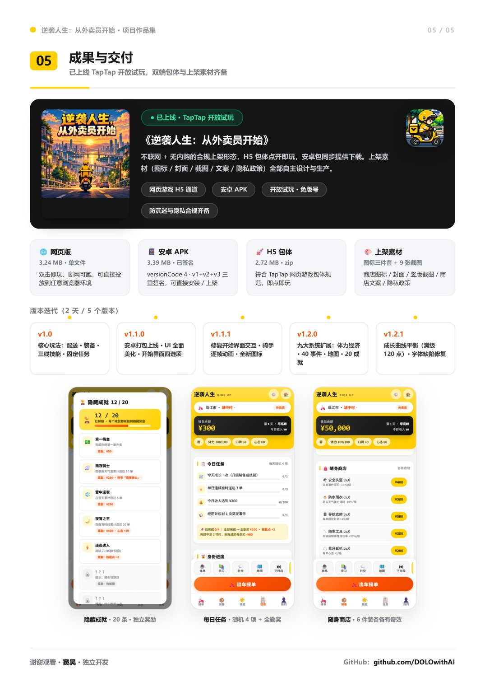

# 逆袭人生：从外卖员开始

> 零依赖单文件 HTML5 模拟经营游戏 · 已上线 TapTap 开放试玩
> 策划 / 程序 / 美术 / 上架，由一个人 + 一套 AI 自动化工作流独立完成

[-c8102e)](./逆袭人生-项目作品集.pdf)
[](https://www.taptap.cn/app/963531)
[]()
[]()

---

## 一句话

一个外卖员从城中村出发的完整人生。

玩家扮演刚到临江市的外卖骑手**陈默**：从城中村出发，靠一单一单的配送攒钱，升级装备、点亮技能、解锁更大的城市。

> 没有一夜暴富的爽感，只有一单一单跑出来的踏实——每一笔收入都有出处，每一次成长都看得见来路。

**人生没有快捷键，但你可以一直按「出车接单」。**

📄 **完整项目作品集（6 页）**：[`逆袭人生-项目作品集.pdf`](./逆袭人生-项目作品集.pdf)

---

## 项目规模

| 指标 | 数值 |
|---|---|
| 随机事件 | 40 个 |
| 隐藏成就 | 20 项 |
| 技能分支 | 7 条 |
| 装备 | 10 件 |
| 城市地区 | 6 个 |
| 身份晋升 | 5 阶 |
| AI 自动化工作流 | 15 条 |
| 脚本 | 42 个 / 约 4,000 行代码 |
| 开发周期 | **2 天**完成从 0 到上架 |
| 版本迭代 | 5 个版本 |

---

## 基础信息

| | |
|---|---|
| **游戏类型** | 模拟经营 · 像素风 · 竖屏单手操作 |
| **平台与状态** | PC 网页端 + 安卓 · TapTap 开放试玩已上线 |
| **技术形态** | 零依赖单文件 HTML5 · 3.24 MB · 双击即玩 |
| **开发方式** | 单人 + AI 工作流 · 2 天 / 5 个版本迭代 |
| **商业形态** | 无内购 · 不联网 · 单机即玩 |
| **版本** | v1.2.1 · 2026.10 |

**核心循环**

接单（看距离 / 体力 / 收益）→ 配送（骑手逐帧动画 · 突发选择）→ 结算（收入 / 口碑 / 心态）→ 升级（技能 / 装备 / 身份）→ 解锁新地区（收益 ×1 → ×5）

---

## 玩法与系统

六大系统撑起长线成长，每个选择都有代价与回报。

| 系统 | 说明 |
|---|---|
| ⚡ **体力经济** | 单次配送体力消耗 ×4，休息、日结、装备与天气共同决定「今天能跑几单」。体力成为核心资源，每一次出车都是取舍，休息也不再是浪费时间。 |
| 🎲 **事件后果系统** | 40 个随机事件，选择前不剧透后果；选对给奖励、选错给惩罚，不少「好事」还附带体力或心态的副作用。选择后弹出结果卡，逐项列出得失明细。 |
| 🏆 **20 条隐藏成就** | 雨夜骑士、夜宵之王、猫的报恩……每条成就都配独立隐藏奖励与称号，未解锁时只给一句模糊提示。成就页从开始界面即可进入，随时回顾进度。 |
| 🗺️ **城市地图** | 6 个地区按条件逐步解锁：收益 ×1 到 ×5，距离与体力消耗同步放大。城中村到国际新城，跑得越远，越需要装备与技能兜底。 |
| 📋 **每日任务** | 每天从任务池随机抽 4 项：全勤奖 ¥100 + 技能点，完成不足则按条罚款。用每日目标替代无脑刷单，让「今天跑不跑」成为真实的决策。 |
| 🌟 **长线成长体系** | 7 条技能分支（主技能 20 级 / 辅助 15 级，满级共 120 技能点）、10 件装备（载具 4 + 随身商店 6）、5 阶身份晋升，成长曲线专门为长线游玩校准。 |

---

## 技术实现

零依赖单文件架构，从构建到打包全链路脚本化。

**📦 单文件架构**
整个游戏是一个 3.24 MB 的 HTML 文件：界面、逻辑、美术资源（base64 贴图 + 逐帧精灵表）全部内联，零外部依赖——双击即玩、断网可跑，也天然适配 WebView 外壳。

**🏗️ 三源料构建管线**
皮肤（CSS）、结构（HTML）、逻辑（JS）拆成三份源料分开维护，由构建脚本自动合成产物；关键数值补丁带命中断言，防止误改，产物可字节级复现。

**📱 安卓离线打包链**
不使用 Android Studio 与 Gradle：`aapt2 → javac → d8 → zipalign → apksigner` 全链路脚本化，一条命令产出 3.39 MB 已签名 APK；WebView 原生桥负责存档镜像、震动与返回键。

**🧪 自动化质量保障**
无头浏览器注入 64 项断言跑通全流程（含老存档兼容升级）；交互做命中测试防止「点了没反应」，动画做逐帧比对验证真的在动，每次发版前全量回归。

**构建链路**

```
三份源料                 构建脚本                单文件 HTML
CSS 皮肤 / HTML 结构  →  自动合成 + 补丁断言  →   3.24 MB · 零依赖
/ JS 逻辑
                              ├─ 安卓链   → 已签名 APK 3.39 MB
                              ├─ zip 打包 → H5 包体 2.72 MB
                              └─ 截图流水线 → 商店图 1080×1920
```

PC 网页端采用响应式三栏布局（≥1000px 自动展开，手机端自动切换为底部 Tab 栏）。

---

## AI 协作工作流

> **我负责决定「要什么」，AI 负责「怎么做到」。**

项目中我承担「产品负责人 + 验收者」的角色：定义玩法与目标，拆解任务，验收每一个产物。从策划文案、游戏逻辑、逐帧动画、应用图标，到双端打包与上架物料，由 **15 条自动化工作流 / 42 个脚本 / 约 4,000 行代码** 协作产出。

| # | 工作流 | 内容 |
|---|---|---|
| 01 | 骑手逐帧动画流水线 | 14 帧自动拆分 → 抠底 → 对齐归一化 → 去速度线 → 12 帧定稿 |
| 02 | 游戏图标生成流水线 | 源图 → 安全区构图 → 5 档密度 + 商店图标三件套 |
| 03 | 精灵表合成与内嵌 | 12 帧并集裁切 → 静态精灵表 → 自动注入 HTML |
| 04 | 商店截图生产 | CDP 精确设备模拟，批量产出 1080×1920 竖版截图 |
| 05 | 单文件 HTML 构建合并 | 三源料 → 产物 + 补丁断言，防误改、可复现 |
| 06 | 广告奖励模块 | 6 种加权奖励 + 每日限次 + 双倍卡（本地模拟） |
| 07 | UI 皮肤体系 | 主色 / 圆角卡 / 七层 z-index 分层 / 响应式断点 |
| 08 | 无头浏览器功能自测 | 注入脚本跑点击流程，DOM 回读 + 零报错断言 |
| 09 | 命中测试与动画帧差验证 | 定位遮挡 bug、验证动画逐帧推进 |
| 10 | 构建可重复性校验 | 哈希基线比对，确认每次产出字节级一致 |
| 11 | 安卓 APK 一键打包 | aapt2 → javac → d8 → zipalign → apksigner |
| 12 | WebView 原生桥 | 存档镜像 / 震动 / 屏幕常亮 / 返回键接管 |
| 13 | H5 包体打包与自检 | zip 规范断言 + HTTP 逐字节一致性校验 |
| 14 | 上架物料生产 | 图标三件套 + 9 张截图 + 商店文案 + 隐私政策 |
| 15 | 可复用技能库沉淀 | 5 个技能 / 9 个脚本，把流程固化为下次可直接复用 |

**沉淀**：42 个自动化脚本 · ≈4,000 行脚本代码 · 64 项自动化断言 · 5 个可复用技能

**示例 · 每次发版前的自动化回归**（工作流 08 → 10 串联，实跑 64 项断言）

```
启动无头浏览器    注入测试脚本      跑完整点击流程    回读 DOM 状态     断言比对 64 项      截图留档
本机 Chrome /  →  模拟真实操作  →  接单/事件/购买  →  数值与界面   →  含老存档兼容   →  零报错才
零依赖            路径              /结算             双向核对          用例              允许发版
```

---

## 成果与交付

**● 已上线 · TapTap 开放试玩**

🔗 **游戏主页**：https://www.taptap.cn/app/963531
📅 **上线日期**：2026-10-07 · 官方入驻 · 创意工坊

不联网 + 无内购的合规上架形态，H5 包体点开即玩，安卓包同步提供下载。上架素材（图标 / 封面 / 截图 / 文案 / 隐私政策）全部自主设计与生产。

| 交付物 | 规格 |
|---|---|
| 🌐 **网页版** | 3.24 MB · 单文件。双击即玩、断网可跑，可直接投放到任意浏览器环境 |
| 📱 **安卓 APK** | 3.39 MB · 已签名。versionCode 4 · v1+v2+v3 三重签名，可直接安装 / 上架 |
| 🚀 **H5 包体** | 2.72 MB · zip。符合 TapTap 网页游戏包体规范，即点即玩 |
| 🎨 **上架素材** | 图标三件套 + 9 张截图 + 商店文案 + 隐私政策 |

**合规**：开放试玩（免版号）· 防沉迷与隐私合规齐备

### 版本迭代（2 天 / 5 个版本）

| 版本 | 更新内容 |
|---|---|
| v1.0 | 核心玩法：配送 · 装备 · 三线技能 · 固定任务 |
| v1.1.0 | 安卓打包上线 · UI 全面美化 · 开始界面四选项 |
| v1.1.1 | 修复开始界面交互 · 骑手逐帧动画 · 全新图标 |
| v1.2.0 | 九大系统扩展：体力经济 · 40 事件 · 地图 · 20 成就 |
| v1.2.1 | 成长曲线平衡（满级 120 点）· 字体缺陷修复 |

---

## 作品集预览

| 封面 | 项目概览 | 玩法与系统 |
|---|---|---|
|  |  |  |

| 技术实现 | AI 协作工作流 | 成果与交付 |
|---|---|---|
|  |  |  |

**TapTap 上线实况**

| 详情页 | 实机画面 |
|---|---|
|  |  |

---

## 链接

- 🎮 **TapTap 游戏主页**（开放试玩）：https://www.taptap.cn/app/963531
- 👤 **GitHub 主页**：https://github.com/DOLOwithAI
- 🤖 **AI 网申管家**（开源项目）：https://github.com/DOLOwithAI/ai-apply-manager
- 🎨 **AI 设计作品集**：https://github.com/DOLOwithAI/ai-design-portfolio

---

<sub>© 2026 窦昊 · 独立开发。本作品集内所有内容版权归原作者所有，未经许可请勿转载或商用。</sub>
